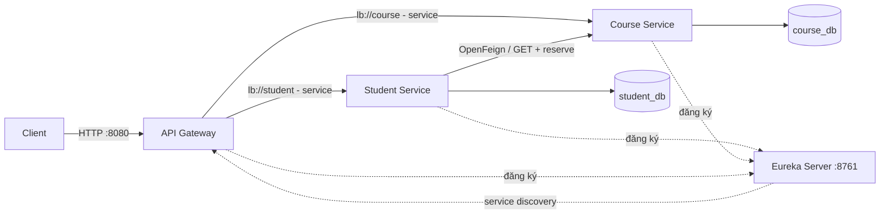

# Microservices quản lý sinh viên & khóa học

Bài làm theo `ĐỀ KIỂM TRA_ MICRO SERVICES VỚI SPRING BOOT – QUẢN LÝ SINH VIÊN & KHÓA HỌC`: Java 17, **Spring Boot 3.5.14**, Spring Cloud **2025.0.3**, Gradle **8.14.3**, PostgreSQL 16. Chọn **Cách A – OpenFeign**. Không cần Kafka.

## 1. Kiến trúc



| Module | Cổng chạy local | Trách nhiệm |
|---|---:|---|
| `service-registry` | 8761 | Eureka Server, quản lý danh bạ dịch vụ |
| `api-gateway` | 8080 | Route bằng tên dịch vụ, Global Filter log Time/Method/URI |
| `student-service` | 8081 | Sinh viên, đăng ký khóa học, OpenFeign |
| `course-service` | 8082 | Khóa học, kiểm tra và trừ chỗ |

Mỗi service có main class, cấu hình, JAR và tiến trình riêng; chạy độc lập bằng `bootRun` hoặc `java -jar`. Hai service nghiệp vụ sở hữu hai database riêng, không truy vấn database của nhau. Flyway tạo schema; Hibernate chỉ `validate` schema.

### Tổ chức package

Hai service nghiệp vụ tách theo trách nhiệm:

```text
vn.edu.student / vn.edu.course
├── controller   # HTTP endpoints, kiểm tra DTO và gọi service
├── dto          # Request/contract records
├── entity       # JPA entities
├── repository   # Spring Data JPA, truy vấn và khóa DB
├── service      # Nghiệp vụ và transaction
├── exception    # BusinessException, ApiExceptionHandler
├── filter       # HTTP logging, requestId/MDC
└── client, config  # Student: OpenFeign và truyền requestId
```

Gateway tách `filter` và `exception`; main application nằm ở package gốc để Spring quét các package con. Lombok được cấu hình bằng `compileOnly` + `annotationProcessor`: dùng `@Getter`, `@NoArgsConstructor`, `@RequiredArgsConstructor`, `@Slf4j`. DTO dùng Java record để giữ contract ngắn gọn và bất biến. Entity không dùng `@Data` để tránh sinh setter/equals/toString không phù hợp với JPA.

### Lỗi và logging

Lỗi trả theo Problem Detail, bổ sung `code`, `timestamp`, `requestId`, `errors` và `instance`. Ví dụ:

```json
{
  "type": "about:blank",
  "title": "Conflict",
  "status": 409,
  "detail": "Khóa học 1 đã hết chỗ",
  "instance": "/api/students/enroll",
  "code": "COURSE_FULL",
  "timestamp": "2026-11-18T12:00:00Z",
  "requestId": "demo-123",
  "errors": []
}
```

Mã nghiệp vụ: `STUDENT_NOT_FOUND`, `COURSE_NOT_FOUND`, `ALREADY_ENROLLED`, `COURSE_FULL`, `COURSE_SERVICE_UNAVAILABLE`. Lỗi đầu vào: `VALIDATION_ERROR` kèm `errors: [{field, message}]`, `INVALID_JSON`, `HTTP_400` cho path sai kiểu dữ liệu. Ngoài ra có `DATA_CONFLICT`, `DATABASE_BUSY`, `INTERNAL_ERROR`; lỗi từ Gateway có `ROUTE_NOT_FOUND`, `SERVICE_UNAVAILABLE`. HTTP 405 vẫn giữ header `Allow`. Lỗi 500 trả thông báo chung; stack trace chỉ ghi ở server.

Mỗi request nhận header `X-Request-Id` (tự sinh nếu thiếu/sai định dạng) và trả lại header này. Gateway truyền ID đến Student, Feign truyền tiếp đến Course; log servlet gắn ID vào MDC. HTTP log có thời gian, method, path, status và durationMs. Nghiệp vụ log ID sinh viên/khóa học, bước gọi Feign, giữ chỗ mới/tái sử dụng, capacity sau cập nhật; 4xx dùng WARN, lỗi hệ thống dùng ERROR kèm stack trace. Log sau `saveAndFlush` ghi rõ đang chờ commit. Không ghi request body, email, mật khẩu hoặc query string vào access log.

Có thể truyền ID để tra cứu bằng:

```bash
curl -H 'X-Request-Id: demo-123' http://localhost:8080/api/students/1
docker compose logs student-service course-service api-gateway | rg demo-123
```

## 2. Chạy bằng Docker Compose

Cần Docker Engine và Docker Compose v2, có Internet lần build đầu. Không cần cài Java/Gradle trên máy khi chạy Docker.

```bash
cp .env.example .env
docker compose up --build -d
docker compose ps
docker compose logs -f api-gateway student-service course-service
```

- Eureka Dashboard: http://localhost:8761 — sau khi khởi động phải có `API-GATEWAY`, `STUDENT-SERVICE`, `COURSE-SERVICE`.
- API Gateway: http://localhost:8080.
- PostgreSQL sinh viên: `localhost:5433/student_db`, user `student`.
- PostgreSQL khóa học: `localhost:5434/course_db`, user `course`.
- Mật khẩu mặc định trong `.env.example`, có thể thay trước lần khởi tạo database đầu tiên. Khi chạy local phải truyền mật khẩu tương ứng qua `DB_PASSWORD`.
- Student/Course trong Compose chỉ mở cổng trong mạng Docker, không publish ra host. API nội bộ giữ chỗ không được route qua Gateway.
- Đợi các service đăng ký và Eureka/Gateway cập nhật danh bạ (thường vài chục giây). Health Gateway: `GET /actuator/health`; log request có dạng `Time=... Method=POST URI=http://localhost:8080/api/students/enroll`.

```bash
# Mở requests.http trong IntelliJ và chạy từng request.
# Dừng, giữ nguyên dữ liệu:
docker compose down
# Chỉ dùng khi muốn xóa toàn bộ dữ liệu của bài demo:
# docker compose down -v
```

Khi chạy lại request tạo sinh viên, hãy đổi email để tránh lỗi trùng dữ liệu.

## 3. Chạy từng service trên máy

Cần **JDK 17** (đặt `JAVA_HOME` trỏ đến JDK 17) và Docker cho database. Gradle Wrapper đã kèm trong repository.

```bash
./gradlew clean build
# Windows dùng gradlew.bat thay ./gradlew.
docker compose up -d student-db course-db
```

Mở 4 terminal, chạy theo thứ tự sau:

```bash
./gradlew :service-registry:bootRun
./gradlew :course-service:bootRun
./gradlew :student-service:bootRun
./gradlew :api-gateway:bootRun
```

Hoặc build rồi chạy `java -jar student-service/build/libs/student-service.jar` (tương tự module khác).

| Biến môi trường | Mặc định local | Ý nghĩa |
|---|---|---|
| `SERVER_PORT` | Theo module | Cổng của instance |
| `EUREKA_URL` | `http://localhost:8761/eureka/` | URL registry |
| `DB_URL` | `jdbc:postgresql://localhost:5433/student_db` hoặc `:5434/course_db` | JDBC database của service |
| `DB_USERNAME` | `student` / `course` | Tài khoản database |
| `DB_PASSWORD` | `student_secret` / `course_secret` | Mật khẩu database |

## 4. API và chạy thử

Có thể mở `requests.http` bằng IntelliJ HTTP Client để chạy tuần tự và tự lưu ID trả về. Tất cả ví dụ đi qua Gateway. Trường JSON dùng camelCase; cột PostgreSQL dùng snake_case (`course_name`, `enrolled_courses`). `capacity` trong bài làm là **số chỗ còn lại**, giảm 1 khi đăng ký thành công theo yêu cầu đề.

| Method | Endpoint | Kết quả |
|---|---|---|
| POST | `/api/students` | Tạo sinh viên, HTTP 201 và Location |
| GET | `/api/students` | Danh sách sinh viên |
| GET | `/api/students/{id}` | Chi tiết và `enrolledCourses` |
| POST | `/api/students/enroll` | Đăng ký, trả sinh viên đã cập nhật, HTTP 200 |
| POST | `/api/courses` | Tạo khóa học, HTTP 201 và Location |
| GET | `/api/courses` | Danh sách khóa học |
| GET | `/api/courses/{id}` | Thông tin khóa học và số chỗ còn lại |

```bash
curl -i -X POST http://localhost:8080/api/students \
  -H 'Content-Type: application/json' \
  -d '{"name":"Nguyễn Văn An","email":"an@example.com"}'

curl -i -X POST http://localhost:8080/api/courses \
  -H 'Content-Type: application/json' \
  -d '{"courseName":"Microservices với Spring Boot","capacity":2,"credits":3}'

# Thay ID bên dưới bằng ID trả về khi tạo:
curl -i -X POST http://localhost:8080/api/students/enroll \
  -H 'Content-Type: application/json' \
  -d '{"studentId":1,"courseId":1}'

curl http://localhost:8080/api/students/1
curl http://localhost:8080/api/courses/1
```

Kết quả sinh viên ví dụ: `{"id":1,"name":"Nguyễn Văn An","email":"an@example.com","enrolledCourses":[1]}`. Khóa học còn `capacity: 1`.

- **400**: tên rỗng, email sai, thiếu ID/ID không dương, capacity âm, credits không dương.
- **404**: sinh viên hoặc khóa học không tồn tại.
- **409**: đã đăng ký, hết chỗ hoặc email trùng (email được chuẩn hóa chữ thường).
- **503**: Course Service mất kết nối, timeout hoặc lỗi máy chủ. Sinh viên chưa được cập nhật; có thể gửi lại cùng cặp ID.
- Lỗi nghiệp vụ/validation trả `ProblemDetail` gồm `type`, `title`, `status`, `detail`.

Không cung cấp cập nhật/xóa sinh viên hoặc khóa học vì đề không yêu cầu và việc xóa cần thêm quy tắc liên quan đến đăng ký.

## 5. Luồng đăng ký và tính nhất quán

1. Student Service nhận `{studentId, courseId}`, mở transaction và khóa dòng sinh viên bằng `PESSIMISTIC_WRITE`.
2. Kiểm tra sinh viên tồn tại và chưa có courseId trong `enrolled_courses`.
3. OpenFeign gọi `GET /api/courses/{courseId}` thông qua tên `course-service` để lấy thông tin, kiểm tra khóa học tồn tại.
4. Feign gọi API nội bộ `POST /internal/courses/{id}/reservations` với `{studentId}`. Course Service khóa dòng khóa học trong một transaction, kiểm tra `capacity > 0`, lưu reservation và trừ chỗ cùng transaction. Kiểm tra tại bước này là quyết định cuối cùng, tránh race condition giữa GET và thao tác cập nhật.
5. Student Service thêm ID vào mảng PostgreSQL `BIGINT[]` và commit.

Khóa ở PostgreSQL có hiệu lực giữa các instance nên scale nhiều service vẫn không vượt quá số chỗ và không mất cập nhật mảng sinh viên. Ràng buộc DB bảo đảm `capacity >= 0`. Reservation có khóa duy nhất `(student_id, course_id)`: gọi lại sau timeout không trừ thêm chỗ, kể cả lúc khóa học đã đầy. Đăng ký lại sau khi sinh viên đã được cập nhật trả 409.

**Giới hạn transaction phân tán:** hai database không có transaction chung. Nếu Course Service commit giữ chỗ nhưng Student Service bị tắt hoặc commit thất bại, có thể tạm thời còn reservation mà mảng sinh viên chưa được cập nhật. Gửi lại cùng cặp ID sẽ tận dụng reservation cũ và hoàn tất. Bài làm chưa có job tự đối soát/TTL; nếu client không retry, cần đối soát thủ công. Không tự trả chỗ ngay khi timeout vì chưa biết request phía Course đã commit hay chưa. Hệ thống production có thể dùng saga với trạng thái xác nhận/hủy, outbox và job đối soát để xử lý triệt để. Đây không phải bảo đảm atomic tuyệt đối giữa hai dịch vụ.

API `/internal/**` chỉ dành cho các service trong mạng tin cậy, không có route public. Bài tập chưa triển khai xác thực giữa service.

## 6. Kiểm thử

```bash
# Unit test, không cần Docker:
./gradlew test
# Test tích hợp thật trên PostgreSQL, cần Docker đang chạy:
./gradlew :student-service:integrationTest :course-service:integrationTest
# Toàn bộ luồng thật qua Gateway và Eureka, cần stack đang chạy:
# Mở requests.http trong IntelliJ và chạy từng request.
```

- Unit: đăng ký thành công, sinh viên/khóa học không tồn tại, trùng, hết chỗ, upstream lỗi; giữ chỗ idempotent và Global Filter log đủ trường.
- Integration: Flyway/Hibernate trên PostgreSQL thật, lưu/đọc mảng BIGINT[], HTTP validation và chống đăng ký trùng; 12 request giữ chỗ đồng thời vào khóa học có 3 chỗ, chỉ 3 thành công.
- Kiểm thử HTTP trên stack tạm của bản refactor: đăng ký/lưu mảng khóa học, mã lỗi và validation, requestId xuyên ba service, route không tồn tại, 12 sinh viên tranh 3 chỗ chỉ có 3 đăng ký thành công. Dùng `requests.http` để thử các API thủ công.
- Báo cáo HTML: `<module>/build/reports/tests/test/index.html` và `integrationTest/index.html`.

### Kết quả xác minh ngày 18/11/2026

Đã chạy thành công bằng JDK 17: `./gradlew build` (19 unit test), hai task `integrationTest` (4 test PostgreSQL thật), và kiểm thử HTTP trên stack tạm với đủ 4 JAR đang chạy, discovery qua Eureka và request qua Gateway. Đã xác nhận log có đủ Time/Method/URI. `docker compose config --quiet` hợp lệ; hai PostgreSQL trong Compose khởi động healthy. Chưa build thử toàn bộ image ứng dụng Docker. Stack kiểm thử bản refactor dùng cổng và PostgreSQL tạm riêng, đã được dọn sau khi hoàn tất; các dịch vụ đang chạy của người dùng được giữ nguyên.

## 7. Task 3 – Phân tích kiến trúc

### 7.1. Service Discovery: vì sao Gateway không gọi trực tiếp IP/port?

Các instance đăng ký tên dịch vụ, IP, port và gửi heartbeat đến Eureka. Gateway và OpenFeign lấy danh bạ từ Eureka rồi Spring Cloud LoadBalancer chọn một instance. Gateway định tuyến `lb://student-service` và `lb://course-service`, không gắn với địa chỉ vật lý cố định.

Khi container khởi động lại, IP thay đổi, hoặc thêm/bớt instance, danh bạ cập nhật mà không phải sửa route. Gọi IP/port trực tiếp sẽ buộc quản trị địa chỉ thủ công và khó cân bằng tải/failover. Discovery dùng cache và heartbeat nên có độ trễ; instance vừa chết có thể còn xuất hiện ngắn hạn. Eureka không thay thế load balancer: Eureka cung cấp danh bạ, LoadBalancer chọn đích.

### 7.2. Scale Student Service khi request tăng đột biến

Chạy thêm instance cùng `spring.application.name=student-service`, mỗi instance có địa chỉ/port hoặc container riêng và instance-id riêng. Tất cả đăng ký vào Eureka. Gateway vẫn dùng route cũ và LoadBalancer phân phối request qua danh sách instance mới sau khi cache cập nhật.

```bash
docker compose up -d --scale student-service=3
```

Compose không đặt `container_name` và không publish cổng host cố định cho Student Service nên có thể scale trực tiếp. Khi chạy local, thêm instance bằng `SERVER_PORT=8083 ./gradlew :student-service:bootRun`. Các instance dùng chung `student_db`, ứng dụng không giữ session hay state nghiệp vụ trong bộ nhớ. Khóa database chống cập nhật trùng giữa instance.

Cần theo dõi CPU, latency, pool kết nối và tải database; scale ứng dụng không tự khắc phục nút thắt DB. Với Kubernetes có thể dùng autoscaling dựa trên CPU/request rate. Eureka Dashboard sẽ hiển thị nhiều instance dưới cùng tên dịch vụ.

### 7.3. OpenFeign đồng bộ và Kafka bất đồng bộ

| Tiêu chí | OpenFeign (bài làm) | Kafka |
|---|---|---|
| Phản hồi | Client nhận thành công/thất bại ngay sau xử lý | Thường trả 202 + ID để theo dõi trạng thái |
| Độ đơn giản | Ít hạ tầng, code HTTP dễ hiểu và debug | Cần broker, topic, consumer, correlation ID và quản lý trạng thái |
| Phụ thuộc thời điểm | Course phải sẵn sàng; latency truyền sang Student | Broker đệm request, consumer xử lý khi sẵn sàng |
| Tải tăng đột biến | Dễ nghẽn thread, cần timeout và giới hạn tải | Hàng đợi hấp thụ burst, scale consumer theo partition |
| Nhất quán | Transaction riêng mỗi DB; vẫn cần saga/đối soát nếu có lỗi giữa bước | Eventual consistency, cần saga/outbox, chống event trùng và xử lý thứ tự |
| Lỗi và retry | Timeout có thể không biết phía xa đã commit; cần idempotency | Consumer có thể nhận lại event; cần idempotency, retry và dead-letter topic |
| Trải nghiệm | Thuận tiện khi cần biết đăng ký thành công ngay | Cần UI trạng thái pending/success/rejected và polling hoặc push |

Chọn OpenFeign vì quy mô bài kiểm tra nhỏ và nghiệp vụ muốn phản hồi ngay. Dù dùng Kafka, việc trừ chỗ vẫn cần thao tác atomic tại Course Service; Kafka không tự bảo đảm transaction giữa hai database.

## 8. Đối chiếu yêu cầu nộp bài

| Yêu cầu | Nơi triển khai |
|---|---|
| Eureka Server và đủ 3 client | `service-registry`, cấu hình Eureka của 3 module còn lại |
| Route Student/Course | `api-gateway/src/main/resources/application.yml` |
| Global Filter Time/Method/URI | `RequestLoggingFilter.java` |
| POST enroll và GET course | `StudentController.java`, `CourseController.java` |
| OpenFeign, kiểm tra chỗ, cập nhật 2 DB | `StudentService`, `CourseClient`, `CourseService`, migrations |
| Các service chạy riêng | Main class và Gradle `bootRun`/`bootJar` mỗi module |
| Sơ đồ, câu trả lời Task 3 | README mục 1 và 7 |

Tài liệu tham khảo: [Spring Boot 3.5.14](https://spring.io/blog/2026/04/23/spring-boot-3-5-14-available-now/), [Spring Cloud compatibility](https://spring.io/projects/spring-cloud/), [Gateway configuration](https://docs.spring.io/spring-cloud-gateway/reference/4.3/spring-cloud-gateway-server-webflux/configuration.html).
